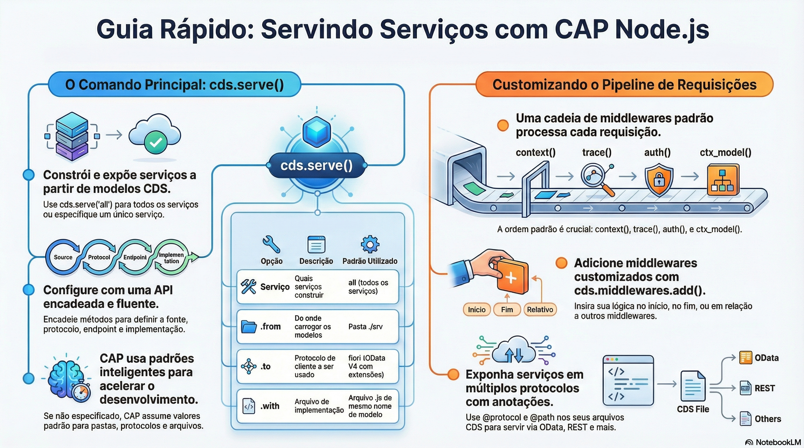

# Bootstrap do servidor e cds.serve

> **Comece pelos slides: [Bootstrap do servidor e cds.serve](./10.05_Bootstrap_do_servidor_e_cds_serve.pptx)**
>
> **Referência oficial (Capire):** [cds.server](https://cap.cloud.sap/docs/node.js/cds-server) · [cds.serve](https://cap.cloud.sap/docs/node.js/cds-serve)

O que acontece do comando cds serve até a primeira requisição: bootstrap, eventos, serviços, middlewares e protocolos.

## O que você vai aprender

- `cds serve` usa o `server.js` embutido: Express, modelo, conexões e serviços
- Em produção, sem `@sap/cds-dk`, use o binário `cds-serve`
- Um `server.js` próprio registra em eventos ou delega a `cds.server`
- `bootstrap`, `served`, `listening` e `shutdown` marcam as etapas
- `cds.serve` usa `.from`, `.to`, `.at`, `.in` e `.with`
- `cds.middlewares.add` ajusta a cadeia, e `@protocol` e `@path` definem o acesso

## Seções da aula

1. **O server.js:** O `server.js` embutido cria o app Express e inicia todos os serviços CAP.
2. **Eventos do ciclo de vida:** Eventos emitidos pela fachada `cds` marcam **cada etapa** do processo.
3. **cds.serve:** A API fluente constrói os serviços. Em geral, `cds.serve('all')` basta.
4. **Middlewares e protocolos:** Cada serviço recebe uma **cadeia de middlewares** antes do adaptador de protocolo.

## Material complementar

- Infográfico: [Anatomia de um Servico](./10.05_Anatomia_de_um_Servico.png)
- Infográfico: [Nodejs Server Mastery](./10.05_Nodejs_Server_Mastery.png)

---

[Voltar ao Módulo 10](../README.md) · Próxima aula: [10.06 A fachada cds e cds.utils](../../modulo-10/10.06%20-%20A%20fachada%20cds%20e%20cds.utils/README.md)
