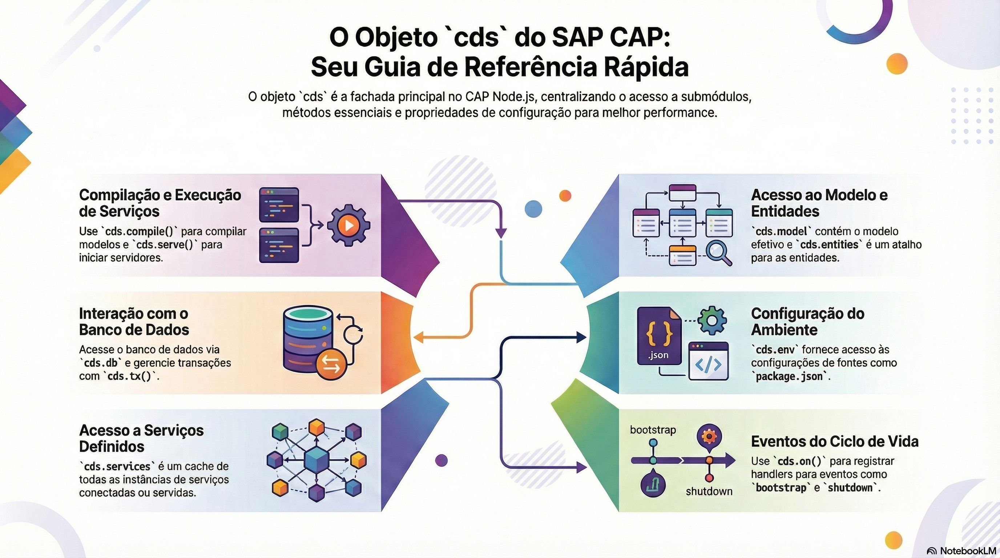

# A fachada cds e cds.utils

> **Comece pelos slides: [A fachada cds e cds.utils](./10.06_A_fachada_cds_e_cds_utils.pptx)**
>
> **Referência oficial (Capire):** [The cds Facade Object](https://cap.cloud.sap/docs/node.js/cds-facade) · [cds.utils](https://cap.cloud.sap/docs/node.js/cds-utils)

Um passeio pelo objeto cds, o ponto de entrada de todas as APIs, e pelos utilitários do dia a dia.

## O que você vai aprender

- `cds` é o ponto de entrada de todas as APIs do CAP em Node.js
- Submódulos são carregados só no primeiro uso, acelerando o início
- Importe classes e funções **sempre** pela fachada
- `cds repl` é o caminho mais rápido para testar uma API
- `cds.error` constrói com `new` e lança sem `new`
- `cds.utils` reúne `uuid`, `ms4`, `read`, `write`, `copy` e `colors`

## Seções da aula

1. **A fachada cds:** Importe **sempre** pela fachada. Experimente as APIs no `cds repl`.
2. **cds.utils:** Pequenas funções evitam **reescrever o básico**: identificadores, arquivos e cores.

## Material complementar

- Infográfico: [Objeto cds Guia Completo](./10.06_Objeto_cds_Guia_Completo.png)
- Infográfico: [cds utils Toolbox](./10.06_cds_utils_Toolbox.png)

---

[Voltar ao Módulo 10](../README.md)
